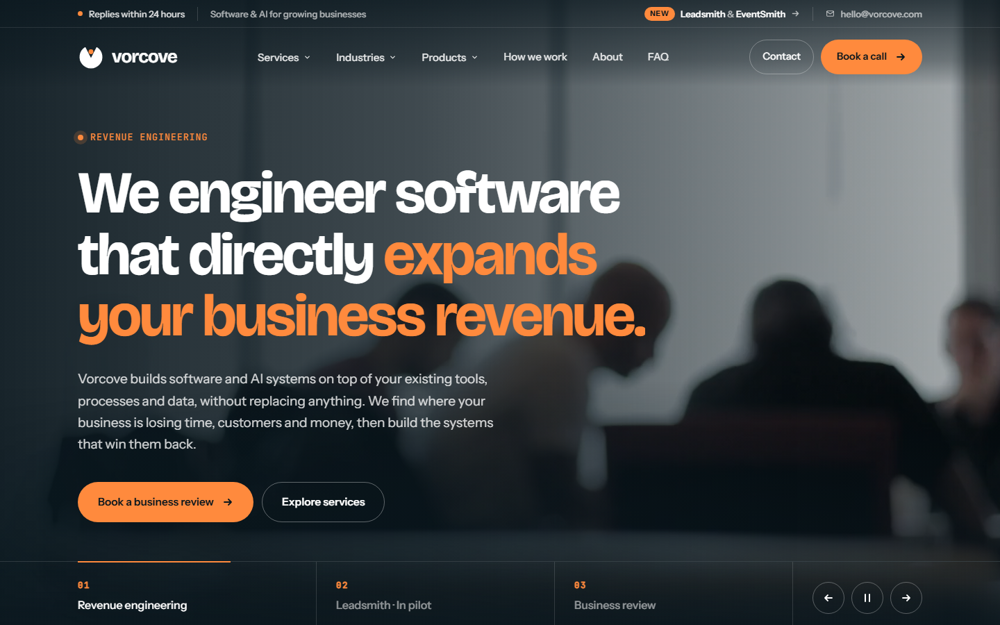

<a id="readme-top"></a>

<div align="center">
  

  <h1>Vorcove</h1>

  <p><strong>We engineer software that directly expands your business revenue.</strong></p>

  <p>
    
    
    
    
    
  </p>

  <p>
    <a href="#getting-started"><strong>Get started</strong></a>
    ·
    <a href="#api-reference">API</a>
    ·
    <a href="https://github.com/sheikhumaryounas/Vorcove/issues/new?labels=bug">Report a bug</a>
    ·
    <a href="https://github.com/sheikhumaryounas/Vorcove/issues/new?labels=enhancement">Request a feature</a>
  </p>
</div>

<br>



<details>
  <summary><strong>Table of contents</strong></summary>

1. [About the project](#about-the-project)
   - [Key features](#key-features)
   - [Built with](#built-with)
2. [Getting started](#getting-started)
   - [Prerequisites](#prerequisites)
   - [Installation](#installation)
   - [Running locally](#running-locally)
3. [Configuration](#configuration)
4. [Available scripts](#available-scripts)
5. [API reference](#api-reference)
6. [Project structure](#project-structure)
7. [Customising the site](#customising-the-site)
8. [Deployment](#deployment)
9. [Troubleshooting](#troubleshooting)
10. [Roadmap](#roadmap)
11. [Credits](#credits)
12. [License](#license)
13. [Contact](#contact)

</details>

---

## About the project

This repository holds the **Vorcove company website**. Vorcove builds software and AI systems on top of a business's existing tools, processes and data, without replacing anything.

The project is a full **MERN** application:

- The **React** frontend is a single-page marketing site with a video hero, scroll animations and live walkthroughs of Vorcove's products, **Leadsmith** and **EventSmith**.
- The **Express + MongoDB** backend receives and stores enquiries from the contact form.

### Key features

| Website | Backend |
| --- | --- |
| Video hero slider with autoplay, progress bars and controls | Contact form API with server-side validation |
| Mega menus (Services, Industries, Products) and a mobile drawer | Enquiries stored in MongoDB |
| Product walkthrough videos that play while they are on screen | Spam protection: honeypot field and rate limiting |
| Smooth scrolling (Lenis) and scroll animations (GSAP ScrollTrigger) | Security headers and a content security policy (Helmet) |
| Animated counters, industry tabs, process timeline, FAQ accordion | Token-protected admin endpoint to list enquiries |
| Responsive from mobile to wide desktop | In-memory MongoDB for zero-setup development |
| Keyboard accessible; respects `prefers-reduced-motion` | One Node process serves the site and the API in production |

### Built with

- **Frontend:** [React 18](https://react.dev), [Vite 6](https://vite.dev), plain CSS with custom properties
- **Motion:** [Lenis](https://github.com/darkroomengineering/lenis), [GSAP 3 + ScrollTrigger](https://gsap.com)
- **Backend:** [Node.js](https://nodejs.org), [Express 4](https://expressjs.com), [Helmet](https://helmetjs.github.io), [express-rate-limit](https://github.com/express-rate-limit/express-rate-limit)
- **Database:** [MongoDB](https://www.mongodb.com) with [Mongoose 8](https://mongoosejs.com), and [mongodb-memory-server](https://github.com/typegoose/mongodb-memory-server) for development
- **Tooling:** npm workspaces, [concurrently](https://github.com/open-cli-tools/concurrently)

<p align="right">(<a href="#readme-top">back to top</a>)</p>

## Getting started

### Prerequisites

- **Node.js 20 or newer**, with npm. Check your version with `node -v`.
- **MongoDB** is *optional* for local development. Without it, a temporary in-memory database starts automatically.

### Installation

1. Clone the repository:

   ```bash
   git clone https://github.com/sheikhumaryounas/Vorcove.git
   cd Vorcove
   ```

2. Install the dependencies. This one command installs the client and the server, through npm workspaces:

   ```bash
   npm install
   ```

3. *(Optional)* Create the server environment file:

   ```bash
   cp server/.env.example server/.env
   ```

### Running locally

```bash
npm run dev
```

| Service | URL |
| --- | --- |
| Website (hot reload) | http://localhost:5173 |
| API | http://localhost:5000 |

Vite forwards every `/api/*` request to Express, so the contact form works straight away.

> [!NOTE]
> The first run downloads a MongoDB binary for the in-memory database (about 600 MB), so it can take a few minutes. To skip this, set `MONGODB_URI` in `server/.env`.

<p align="right">(<a href="#readme-top">back to top</a>)</p>

## Configuration

All settings live in `server/.env`. Start by copying `server/.env.example`.

| Variable | Required | Default | Description |
| --- | :---: | --- | --- |
| `MONGODB_URI` | In production | — | MongoDB connection string. If it is empty in development, an in-memory database is used and its data is lost when the server stops. |
| `PORT` | No | `5000` | Port the server listens on. |
| `ADMIN_TOKEN` | No | — | Secret for `GET /api/leads`. If it is empty, that endpoint is switched off. |
| `NODE_ENV` | In production | — | Set it to `production`. This makes `MONGODB_URI` required. |
| `MONGOMS_VERSION` | No | — | Development only. Picks the MongoDB version the in-memory database uses, e.g. `7.0.14`. |

> [!WARNING]
> `server/.env` is git-ignored. Never commit real credentials.

## Available scripts

Run these from the project root.

| Command | Description |
| --- | --- |
| `npm run dev` | Runs the API (auto-restart) and the website (hot reload) together. |
| `npm run build` | Builds the website into `client/dist`. |
| `npm start` | Starts the server. If `client/dist` exists, it also serves the built website. |
| `npm run dev -w server` | Runs the API only. |
| `npm run dev -w client` | Runs the website only. |

<p align="right">(<a href="#readme-top">back to top</a>)</p>

## API reference

Base URL: `http://localhost:5000/api`. Every response is JSON and includes an `ok` boolean.

| Method | Endpoint | Auth | Description |
| --- | --- | --- | --- |
| `GET` | `/health` | — | Server and database status |
| `POST` | `/leads` | — | Submit a contact-form enquiry |
| `GET` | `/leads` | Bearer token | List the 200 most recent enquiries |

<details>
<summary><code>GET /api/health</code></summary>

<br>

```json
{ "ok": true, "db": "connected" }
```

</details>

<details>
<summary><code>POST /api/leads</code>: submit an enquiry</summary>

<br>

Each IP address can send at most **10 requests every 15 minutes**.

**Request body**

| Field | Type | Rules |
| --- | --- | --- |
| `business` | string | Required, up to 120 characters |
| `email` | string | Required, a valid email address, up to 160 characters |
| `message` | string | Required, up to 3000 characters |
| `website` | string | Honeypot. Leave it empty; when it is filled in, the request is ignored. |

**Example**

```bash
curl -X POST http://localhost:5000/api/leads \
  -H "Content-Type: application/json" \
  -d '{"business":"Acme Fabrication","email":"owner@acme.co.uk","message":"We lose quotes after sending them."}'
```

**Responses**

| Status | Body |
| --- | --- |
| `201 Created` | `{ "ok": true }` |
| `400 Bad Request` | `{ "ok": false, "errors": { "email": "Please enter a valid email address." } }` |
| `429 Too Many Requests` | Rate limit reached |
| `500 Server Error` | `{ "ok": false, "error": "Something went wrong. Please try again." }` |

</details>

<details>
<summary><code>GET /api/leads</code>: list enquiries (admin)</summary>

<br>

```bash
curl -H "Authorization: Bearer <ADMIN_TOKEN>" http://localhost:5000/api/leads
```

| Status | Meaning |
| --- | --- |
| `200 OK` | `{ "ok": true, "leads": [ ... ] }`, newest first |
| `401 Unauthorized` | The token is missing or wrong |
| `404 Not Found` | `ADMIN_TOKEN` is not set, so the endpoint is off |

**Lead fields:** `business`, `email`, `message`, `status`, `createdAt`, `updatedAt`. The `status` field is `new`, `contacted` or `closed`.

</details>

<p align="right">(<a href="#readme-top">back to top</a>)</p>

## Project structure

<details>
<summary>Show folder tree</summary>

<br>

```text
Vorcove/
├── client/                     React website (Vite)
│   ├── public/
│   │   ├── favicon.svg
│   │   └── media/              Product videos and posters
│   ├── src/
│   │   ├── components/         One file per page section
│   │   ├── data/content.js     All website text, images and video URLs
│   │   ├── lib/motion.js       Smooth scrolling and scroll animations
│   │   ├── App.jsx             Section order
│   │   ├── index.css           Styles; brand colours and fonts at the top
│   │   └── main.jsx            Entry point
│   ├── index.html
│   └── vite.config.js          Dev server and /api proxy
├── server/                     Express API
│   ├── src/
│   │   ├── models/Lead.js      Enquiry schema
│   │   ├── routes/leads.js     /api/leads endpoints
│   │   ├── db.js               MongoDB connection
│   │   └── index.js            App setup, security and static hosting
│   └── .env.example
├── docs/screenshot.png
└── package.json                Workspaces and root scripts
```

</details>

## Customising the site

| To change | Edit |
| --- | --- |
| Any text: headlines, services, industries, products, FAQ | `client/src/data/content.js` |
| Hero videos and section photos | URLs in `client/src/data/content.js` |
| Product videos and posters | `client/public/media/` |
| Colours and fonts | `:root` variables at the top of `client/src/index.css` |
| Section order | `client/src/App.jsx` |
| Logo | `client/src/components/Logo.jsx` and `client/public/favicon.svg` |

<details>
<summary>Brand colour tokens</summary>

<br>

| Token | Value | Use |
| --- | --- | --- |
| `--ink` | `#0A171E` | Deep sea-ink backgrounds |
| `--navy` | `#0F222B` | Cards and buttons on light sections |
| `--mint` | `#FF8A3D` | Beacon orange accent on dark backgrounds |
| `--accent` | `#B4500F` | Darker orange for readable text on light backgrounds |
| `--sand` | `#F4F2EE` | Light section backgrounds |

Some colours also have an `-rgb` version (e.g. `--ink-rgb`), which transparent overlays use. Update both when you change a colour.

</details>

<p align="right">(<a href="#readme-top">back to top</a>)</p>

## Deployment

### Vercel (recommended)

The repo includes a `vercel.json` that deploys two [Vercel Services](https://vercel.com/docs/services) (beta) as one project:

| Service | Folder | Public path |
| --- | --- | --- |
| `client` | `client/` (Vite) | `/` |
| `server` | `server/` (Express, runs as a Vercel Function) | `/api/*` |

1. Create a free cluster on [MongoDB Atlas](https://www.mongodb.com/atlas).
   - Under **Network Access**, allow `0.0.0.0/0`, because Vercel functions have no fixed IP.
   - Copy the connection string.
2. On [vercel.com/new](https://vercel.com/new), import this repository. Vercel reads `vercel.json` automatically.
3. Under **Settings → Environment Variables**, add:
   - `MONGODB_URI`: your Atlas connection string (required)
   - `ADMIN_TOKEN`: a long random string, needed only to read enquiries
4. Deploy. The site is served at `/` and the API at `/api/*`, on the same domain.

> [!NOTE]
> On Vercel the in-memory database is turned off, so `MONGODB_URI` must be set or the contact form returns an error.

### Any Node host

On a single Node host, **one Node process serves both the website and the API**.

1. **Database:** create a free cluster on [MongoDB Atlas](https://www.mongodb.com/atlas) and copy its connection string.
2. **Host:** use any platform that runs a long-lived Node server, such as [Render](https://render.com), [Railway](https://railway.app), [Fly.io](https://fly.io) or a VPS.

   | Setting | Value |
   | --- | --- |
   | Build command | `npm install && npm run build` |
   | Start command | `npm start` |
   | Environment variables | `NODE_ENV=production`, `MONGODB_URI`, `ADMIN_TOKEN` |

3. **Domain:** connect your domain and turn on HTTPS.

## Troubleshooting

<details>
<summary>Common problems and fixes</summary>

<br>

| Problem | Fix |
| --- | --- |
| `Port 5000 is already in use` | Another server is running. Close it, or set a different `PORT` in `server/.env`. |
| `running scripts is disabled on this system` (Windows) | Run `Set-ExecutionPolicy -Scope CurrentUser RemoteSigned` once, or use `npm.cmd run dev`. |
| `Could NOT download ... mongodb` | The in-memory database could not download MongoDB. Retry on a stable connection, set `MONGOMS_VERSION`, or set `MONGODB_URI`. |
| `MONGODB_URI is required in production` | Set `MONGODB_URI` when `NODE_ENV=production`. |
| The form says "Your message didn't send" | The API is not running. Check the terminal where `npm run dev` is running. |

</details>

## Roadmap

- [x] Responsive marketing site with video hero and product showcases
- [x] Contact form API with MongoDB storage and spam protection
- [ ] Email notifications for new enquiries
- [ ] Self-host the hero videos and photos instead of loading them from Pexels
- [ ] Admin dashboard for managing enquiries
- [ ] Client logos and testimonials

See the [open issues](https://github.com/sheikhumaryounas/Vorcove/issues) for proposed features and known issues.

## Credits

- **Photos and hero videos:** [Pexels](https://www.pexels.com), free to use under the Pexels licence.
- **Fonts:** [Bricolage Grotesque](https://fonts.google.com/specimen/Bricolage+Grotesque), [Instrument Sans](https://fonts.google.com/specimen/Instrument+Sans) and [JetBrains Mono](https://fonts.google.com/specimen/JetBrains+Mono), via Google Fonts.
- **Libraries:** [Lenis](https://github.com/darkroomengineering/lenis) and [GSAP](https://github.com/greensock/GSAP).

## License

© 2026 Vorcove. All rights reserved.

The Vorcove name, logo, the product names Leadsmith and EventSmith, and the website content are proprietary. Third-party libraries and media keep their own licences.

## Contact

**Vorcove**: [hello@vorcove.com](mailto:hello@vorcove.com)

Project link: [github.com/sheikhumaryounas/Vorcove](https://github.com/sheikhumaryounas/Vorcove)

<p align="right">(<a href="#readme-top">back to top</a>)</p>
